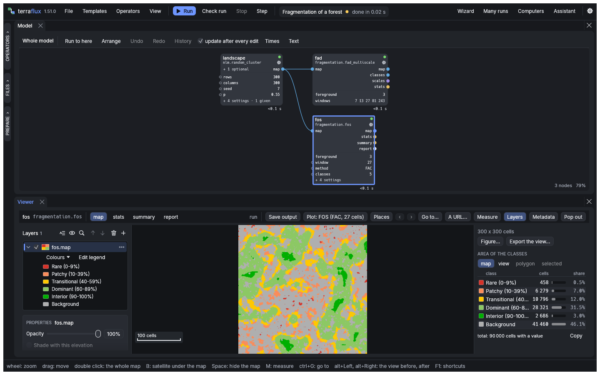
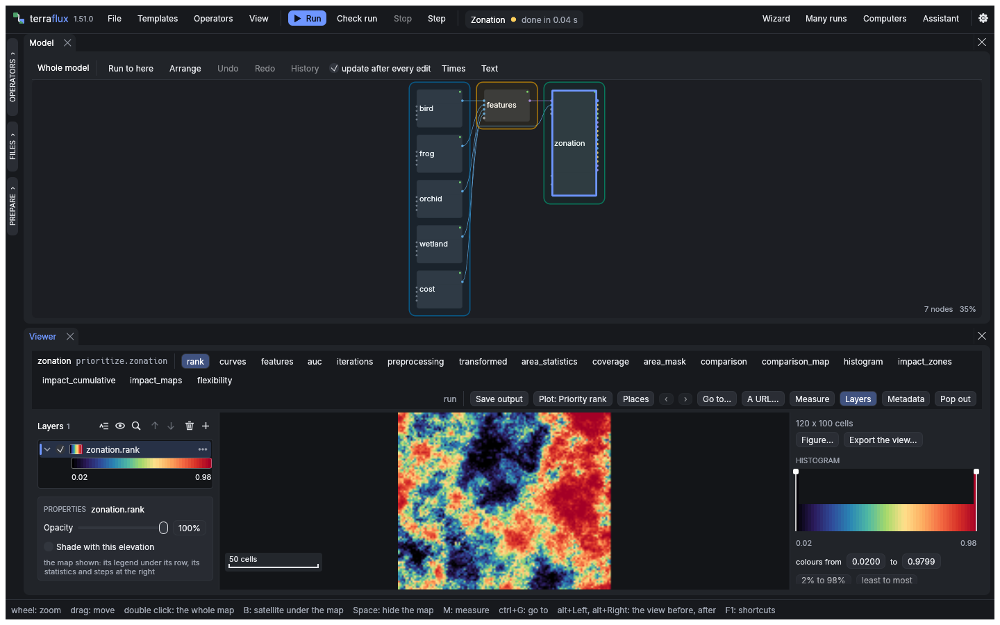
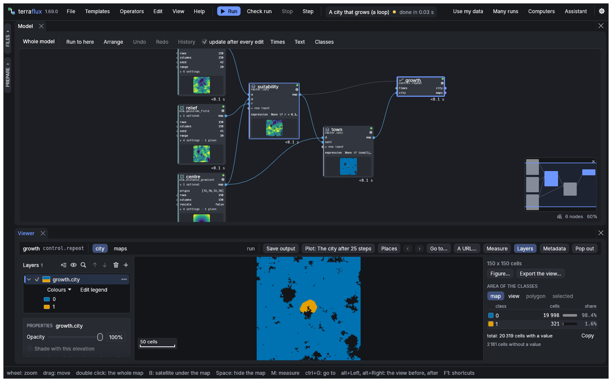
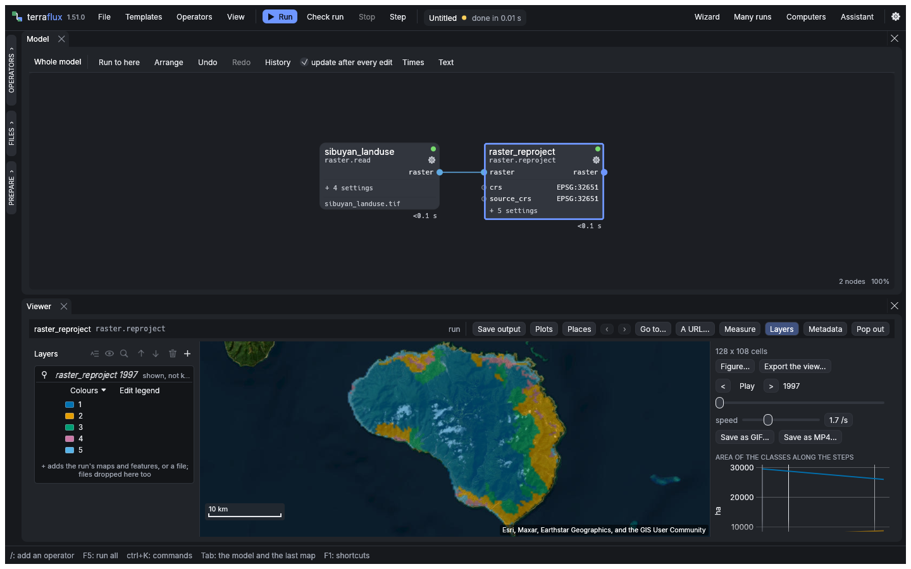
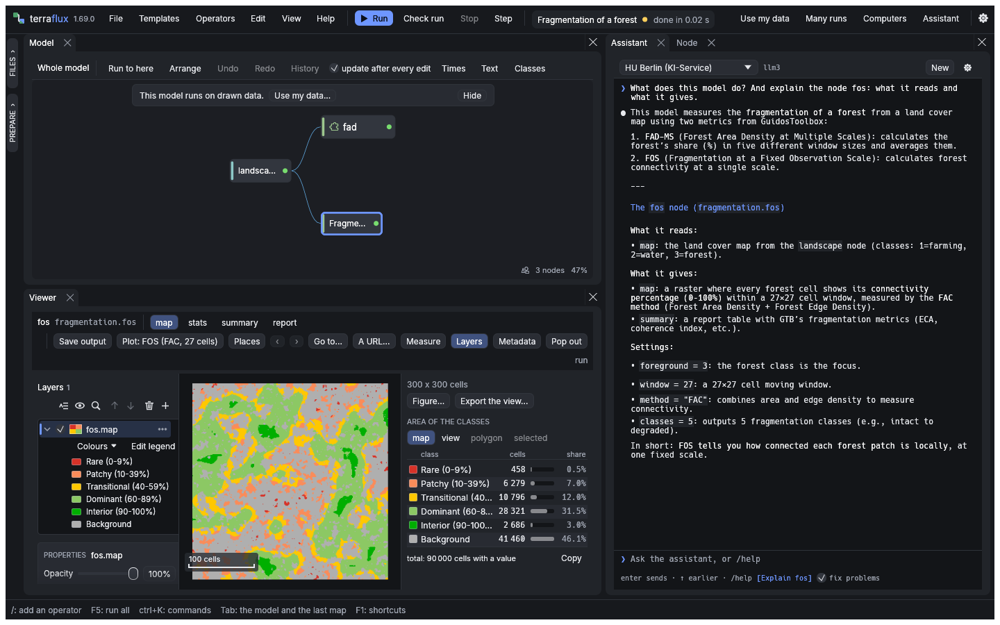
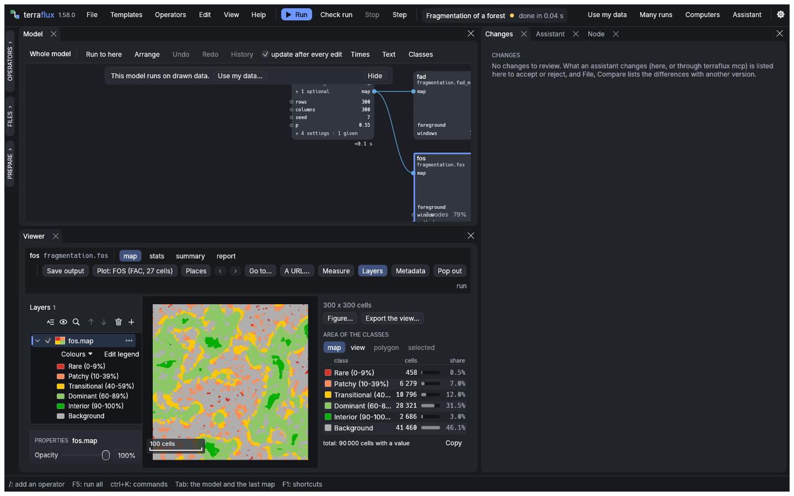
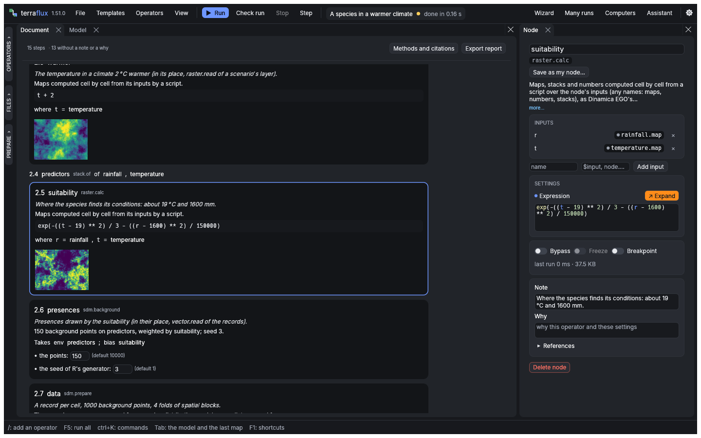

<p align="center">
  <picture>
    <source media="(prefers-color-scheme: dark)" srcset="assets/logo/terraflux-logo-dark.svg">
    
  </picture>
</p>

<p align="center">
  <strong>Landscape ecology, conservation planning, image objects and land change simulation in one open-source application.</strong><br>
  Built on the methods of the reference tools, from a laptop to a cluster.
</p>

<p align="center">
  <a href="https://sacridini.github.io/terraflux/"><strong>Website</strong></a> ·
  <a href="https://sacridini.github.io/terraflux/quickstart/">Quickstart</a> ·
  <a href="https://sacridini.github.io/terraflux/tutorials/">Tutorials</a> ·
  <a href="https://github.com/sacridini/terraflux/releases/latest">Download</a> ·
  <a href="https://github.com/sacridini/terraflux-py">Python library</a>
</p>

<p align="center">
  <a href="LICENSE"></a>
  <a href="https://github.com/sacridini/terraflux/releases/latest"></a>
  <a href="https://doi.org/10.5281/zenodo.24515275"></a>
  
  
</p>

<p align="center">
  <a href="#features">Features</a> ·
  <a href="#installation">Installation</a> ·
  <a href="#quick-start">Quick start</a> ·
  <a href="#the-application">The application</a> ·
  <a href="#scaling-up">Scaling up</a> ·
  <a href="#documentation">Documentation</a> ·
  <a href="#citing-terraflux">Citing</a> ·
  <a href="#building-from-source">Building</a>
</p>

<p align="center">
  
</p>

Terraflux is a native desktop application and command line for spatial ecology. Habitat patterns, landscape
metrics, connectivity, spatial prioritization, restoration planning, species distributions, animal movement,
object-based image analysis and land use change are operators in one visual model builder: connect them node by
node, and every result shows as soon as the graph changes. The same model runs unchanged from the command line,
on a workstation, on the computers of a local network or on a Slurm cluster, and on maps larger than memory.

## Why Terraflux

- **Results you can trust.** The methods follow their reference implementations, and many give the same
  results to the bit: GuidosToolbox, landscapemetrics, Zonation 5, Marxan, Dinamica EGO and lulcc's CLUE-S among
  them. Parity tests against [terraflux-py](https://github.com/sacridini/terraflux-py) run in the
  test suite.
- **No code needed, nothing hidden.** More than 550 operators in a searchable library, 80 ready-to-run templates and
  Use my data, which puts your files in place of a template's drawn data, checks them and puts their grids and
  classes right. Every automatic choice is a visible node, with a note on why it is there.
- **One model, many front-ends.** A model is a typed graph saved as readable text (TOML or JSON). The builder,
  Use my data, the command line and Python all read and write the same file.
- **Any scale.** An exact engine on one machine, and a tiled engine that gives the same maps whatever the number
  of tiles, threads or machines. A quarter of the cores is always left free, so the computer stays usable during a
  long run.

## Features

| Field | What Terraflux does | Methods of |
|---|---|---|
| **Land change simulation** | Dinamica EGO's model (Markov chains, weights of evidence, Expander and Patcher, the Patcher of a stock, endogenous roads), CLUE-S, ordered allocation, PLUS's land expansion analysis and CARS, cellular automata in loops, validation by fuzzy similarity | Dinamica EGO, lulcc, PLUS, terraflux-py |
| **Carbon and REDD+** | Emissions and removals of land change with regrowth curves; Verra's VT0007 deforestation risk maps, their fit, allocation of the expected deforestation and assessment | IPCC, UDef-ARP |
| **Machine learning** | Random forests and histogram gradient boosting of classes or values on tables and maps, their predictions, out-of-bag error, the predictors' importances (impurity, permutation) and partial dependence, the potential of each class to appear; principal components, k-means and self-organizing maps | scikit-learn, terraflux-py |
| **Object-based image analysis** | Segmentation (multiresolution, SLIC, SNIC, Felzenszwalb, mean shift, quickshift, watershed, quadtree, chessboard, Segment Anything) with the scale found by ESP and optimised; objects described by their spectra, shape, texture, neighbours and levels, classified by rules and class trees, nearest neighbours or random forests (samples from points, polygons or an older map), merged, split, grown and edited by hand; change by objects, accuracy against reference objects, polygons for a report | eCognition, InterIMAGE, scikit-image, ESP |
| **Map accuracy and area** | Stratified random samples sized and drawn for a map, the error matrix, user's, producer's and overall accuracies and each class's area with confidence intervals | Olofsson et al. (2014), mapaccuracy |
| **Spatial statistics** | Every cell's trend along a series of maps (Mann-Kendall, Sen's slope), global and local Moran's I (LISA's clusters), Getis-Ord's Gi* hot and cold spots, variograms, ordinary kriging and inverse distance weighting of points | pymannkendall, PySAL's esda, gstat |
| **Habitat patterns** | MSPA (also tiled, for maps larger than memory), SPA, Accounting, FAD and FOS fragmentation, landscape mosaic, spatial entropy, change between two dates | GuidosToolbox |
| **Landscape metrics** | Patch, class and landscape metrics, moving windows, sample plots, time series, spatial signatures with PCA, NMF and clustering | landscapemetrics, FRAGSTATS |
| **Connectivity** | Habitat graphs and Conefor's indices, MSPA networks, circuit theory, least-cost paths and corridors, Linkage Mapper's corridors, pinch points and barriers, random walks, metapopulations (Hanski's incidence function model) | Conefor, Circuitscape, Omniscape, Linkage Mapper, gdistance, MetaLandSim |
| **Conservation planning** | Zonation 5 rankings and projects, Marxan reserves, optimal plans as integer linear programs solved by HiGHS, irreplaceability, multi-action planning | Zonation, Marxan, ProxIRR, Salgado-Rojas et al. (2020) |
| **Restoration** | Ecological intactness, restoration plans under area targets and budgets, trade-off curves | Beyer et al. (2020), Strassburg et al. (2020) |
| **Species distributions** | GBIF records, CoordinateCleaner's tests, thinning, background points (with a target group's sampling bias), spatial folds, MaxNet, GLM and random forests, evaluation and extrapolation (MESS, MOP), dispersal through the periods of a changing climate | dismo, ENMeval, blockCV, usdm, MigClim |
| **Animal movement** | Movebank's tracks read, cleaned and resampled into bursts; distances, speeds, azimuths and turn angles on the ellipsoid; interpolation along great circles, track lines and the azimuthal equidistant CRS of the tracks; steps, their summaries (straightness, sinuosity, mean squared displacement), time of day, fitted step-length and turn-angle distributions, random steps and the covariates of step selection functions; integrated step selection functions with relative selection strength and simulated paths; home ranges (minimum convex polygons, kernels, local convex hulls) and utilization distributions of dynamic Brownian bridges, their contours and overlap; the energy of walking over relief | move2, amt, move2utils, enerscape |
| **Agents** | Macro agents, parcel managers and CRAFTY's competition for land, in the same graph as the cellular automata | CRAFTY |
| **Hydrology and ecosystem services** | Depressions filled and breached, flow directions and accumulation (D8, D-infinity, multiple flow), streams, HAND, watersheds, wetness indices; rivers as a network (points snapped onto it, the land upstream of each link or point, each point's catchment, distances along it, the centrality of the links, the dendritic connectivity index of dams and which to remove); InVEST's carbon, habitat quality, annual water yield and sediment delivery ratio; SWAT+ watershed simulations | WhiteboxTools, pygeoprocessing, hydrographr, riverconn, InVEST, SWAT+ |
| **Surfaces and data** | Terrain, geomorphons, Brazil's Forest Code (APPs of rivers, lakes, springs, slopes and hilltops; Reserva Legal balances), gravity potentials, distances, map algebra, reprojection and resampling, downloads of WorldClim, CHELSA, the Copernicus DEM, SoilGrids, MapBiomas, Hydrography90m and Environment90m, vectors by OGR, zonal statistics, tables filtered, computed, summarised, joined, sorted and pivoted, Monte Carlo uncertainty, global sensitivity (Morris, Sobol) | GDAL, GRASS, exactextractr, dplyr, tidyr |
| **Vector analysis** | PostGIS's spatial predicates (within, contains, intersects, touches, dwithin...) to select and join features (offered by name in the searches: *Within*, *Contains*...), the k nearest features, overlays (intersection, union, difference, symmetric difference, identity), buffers, clips and dissolves, polygons split by lines, shape descriptors (inscribed and bounding circles, elongation), centroids, hulls, simplification, Voronoi polygons, Delaunay triangles, clusters by distance, points along lines and linear referencing, smoothing, coverages simplified without gaps, and the vector calculator over other layers (`within(parks)`, `distance(roads)`); the same functions in Python as `tf.vector` | PostGIS, GEOS, geopandas, shapely |

<table>
  <tr>
    <td width="50%"></td>
    <td width="50%"></td>
  </tr>
  <tr>
    <td align="center"><sub>Spatial prioritization: Zonation's priority rank</sub></td>
    <td align="center"><sub>Land change: a city that grows in a loop of 25 steps</sub></td>
  </tr>
  <tr>
    <td width="50%"></td>
    <td width="50%">
      <h4>The application</h4>
      <ul>
        <li>A node editor drawn by the GPU: 10,000 nodes at about 0.1 ms a frame</li>
        <li>Results shown as the graph changes, from a cache that reruns only what changed</li>
        <li>Rasters of any size shown at once, tiles read at the screen's resolution</li>
        <li>Satellite and map basemaps under the data, maps and vectors stacked</li>
        <li>Rasters and vectors dropped from the file manager become nodes</li>
        <li>Panes you can arrange, and take to another screen</li>
      </ul>
    </td>
  </tr>
  <tr>
    <td align="center"><sub>Basemaps: a land use map over satellite imagery</sub></td>
    <td></td>
  </tr>
</table>

## Installation

Each release ships self-contained packages: GDAL and the runtimes are bundled, nothing else is needed (neither
Python nor a GDAL of your own).

| Platform | Package | Notes |
|---|---|---|
| **Windows** 10 and 11, 64-bit | `terraflux-<version>-x64.msi` | Start menu shortcut, `terraflux` on the `PATH` |
| | `terraflux-<version>-windows-x64.zip` | Portable: unpack anywhere; it updates itself in its folder |
| **macOS**, Apple silicon | `terraflux-<version>-macos-arm64.dmg` | Drag `Terraflux.app` to Applications |
| **Linux** x86-64, glibc 2.39+ (Ubuntu 24.04+, Debian 13+, Fedora 40+, Arch) | `terraflux_<version>_amd64.deb` | `sudo apt install ./terraflux_<version>_amd64.deb` |
| | `terraflux-<version>-1.x86_64.rpm` | Fedora, openSUSE: `sudo dnf install ./terraflux-<version>-1.x86_64.rpm` |
| | `terraflux-<version>-1-x86_64.pkg.tar.zst` | Arch: `sudo pacman -U terraflux-<version>-1-x86_64.pkg.tar.zst` |
| | `terraflux-<version>-linux-x64.tar.gz` | Unpack and run `install.sh`, no root needed |

> [!NOTE]
> The macOS application is signed ad hoc, not notarized: the first time, open it with a right click and **Open**.

<details>
<summary>Making the packages</summary>

```powershell
tools\make-installer.ps1                # Windows: the MSI (WiX 5) and the zip, in target\installer
```

```bash
python3 tools/make-macos-app.py         # macOS: Terraflux.app, the dmg and the zip, in target/macos
python3 tools/make-linux-package.py     # Linux: the folder, the tar.gz, the .deb, the .rpm and Arch's, in target/linux
```

Each script starts from the release build and bundles a GDAL: on Windows the one in `C:\Program Files\GDAL`
(`-Gdal` another), on macOS Homebrew's (`--gdal` another prefix), on Linux the system's (`--gdal` another
prefix; patchelf is needed, dpkg-deb for the .deb and [nfpm](https://nfpm.goreleaser.com) for the .rpm and
Arch's package). Build the Linux packages on the oldest distribution to support. At every tag `vX.Y.Z` GitHub
Actions makes them all (`.github/workflows/release.yml`), tries the Linux ones installed in containers of Ubuntu,
Debian, Fedora and Arch, and publishes them as the tag's release.
Ubuntu's GDAL 3.8 lacks geodesic areas, which some landscape metrics and species distribution steps need:
GDAL 3.9 or later is recommended.

</details>

## Quick start

Open the application with a double click, or from a terminal:

```bash
terraflux app                 # the model builder
terraflux app model.toml      # with a model
```

Start from **Templates**: each runs as soon as it opens, its data drawn by neutral landscape models, and **Use my
data** puts your own files in their place. Open a raster or vectors with **File > Open a raster or vectors...**
(ctrl+O), from the **Files** drawer or by dropping them on the window, then click operators in the library: each
comes connected to the node selected. Press `/` to search the operators from the keyboard, ctrl+K for every
command. The [quickstart](https://sacridini.github.io/terraflux/quickstart/) and the
[tour of the application](https://sacridini.github.io/terraflux/tutorials/getting-started/tour/) take it step by
step.

The same work from the command line:

```bash
# a model from Dinamica EGO's classic one, fitted on two maps 14 steps apart
terraflux new dinamica --t0 landuse.tif:1997 --t1 landuse.tif:2011 --drivers drivers.tif --steps 14 -o model.toml
terraflux check model.toml          # every operator, reference and connection checked
terraflux relink model.toml         # the files it reads not found (another computer?) found again near it
terraflux run model.toml            # output/maps.tif (a band per step), steps.csv, weights.csv
terraflux run model.toml --set seed=7 --out other
terraflux run model.toml --profile  # how long each node took, the slowest first
terraflux reproduce output/manifest.json   # the run again: every output the same, byte for byte?
terraflux test models/              # each model's [[tests]] and check.assert nodes (--update writes the expected)
terraflux report model.toml --run   # model.html: the model as a document, its maps in it (-o report.pdf: a PDF)
terraflux ops                       # the operators and what they do
```

`terraflux new clue` and `terraflux new ordered` make lulcc's CLUE-S and ordered models.

### With an AI assistant

`terraflux mcp` is a [Model Context Protocol](https://modelcontextprotocol.io) server: an assistant such as Claude
Desktop, Claude Code, Gemini CLI or Codex builds, checks and runs models through it, from a request in plain
words, with the same checks as the node editor. With the model open in the application, every edit appears on the
canvas as it is made (ctrl+Z undoes it).

```bash
claude mcp add --scope user terraflux -- terraflux mcp    # Claude Code
gemini mcp add -s user terraflux terraflux mcp            # Gemini CLI
codex mcp add terraflux -- terraflux mcp                  # Codex
```

For Claude Desktop, add to its `claude_desktop_config.json` (Settings, Developer, Edit Config):

```json
{ "mcpServers": { "terraflux": { "command": "terraflux", "args": ["mcp"] } } }
```

The assistant reads the guide of your field before it builds; `check_model` and `run_model` advise it on the
method as a paper's reviewer would (a simulation validated on the map it was calibrated on, metrics of maps in
degrees...); prompts start a workflow by name (`build_model`, `adapt_template`, `review_model`, `explain_cell`).
The application has an assistant of its own too (View, Assistant), with the same tools on the model open. It talks
to any server of OpenAI's chat completions API with tool calling: a university's open models (the HU Berlin's
KI-Service, the GWDG's Chat AI), a model on this computer (Ollama, LM Studio, llama.cpp's server) or a commercial
provider. See [AI assistants](https://sacridini.github.io/terraflux/cli/assistants/).

## The application

Beyond building and running a model, the application answers the questions that come after a result:

- **What did the assistant change?** The **Changes** pane shows an assistant's edits as a pull request's review:
  the nodes, connections and settings before and after, and the maps of the changed nodes side by side, each change
  accepted or rejected. **File, Compare** does the same against the saved file, another file or the last commit.
- **How would a reviewer read it?** The **Document** pane reads the graph as the methods section of a paper: its
  data, preparation, model, validation and results, a step per node with its note, why and settings in words, the
  plots as numbered figures. **File, Export report** writes it as HTML or PDF, as `terraflux report` does.
- **Why does this cell have this value?** Right-click a cell, **Trace this cell**: node by node, the value each gave
  there and how. Two cells, or one cell in two scenarios, are compared to show where they part. An assistant
  explains the same chain (`trace_cell`), from what made the result rather than from what the model should do.
- **Why did it fail?** The **Problems** pane names the node that failed and shows what it was given side by side
  (each input's grid, coordinate system and what differs), with what likely puts it right.
- **What did I run last week?** The **Runs** pane keeps a journal beside the model: each run's values, outputs and
  model as it was, two runs compared. **File, Save a version...** keeps the model under a name, without git.
- **Is it right before a run of hours?** **Check run** runs the model on the part of the map in view, or at 1/2,
  1/4 or 1/8 of the resolution, in seconds. `check.assert` nodes carry a badge of how they fared in the last run.
- **Debugging.** **Step** through a loop, a **Breakpoint** before a node, **Freeze** a node's result on disk, and
  **Stop** the long operators between their parts.
- **Scenarios.** The **Parameters** pane shows the values to change as a form, keeps them as named scenarios and
  compares their maps side by side (`terraflux run --scenario name`).
- **A folder of rasters.** **Run on a folder...** runs a node, and the chain after it, on every raster of a folder,
  file by file, and does not run again the files already done.
- **Map algebra in words.** In the Calculator pane, say what to compute ("the NDVI of img in 3 classes") or ask for
  a script to be explained; the script is tried on a sample of the cells before anything changes.

<table>
  <tr>
    <td width="50%"></td>
    <td width="50%"></td>
  </tr>
  <tr>
    <td align="center"><sub>The application's assistant explaining a node</sub></td>
    <td align="center"><sub>The review of a change made by the assistant</sub></td>
  </tr>
</table>



Every pane, menu and key is described in [the application's reference](https://sacridini.github.io/terraflux/app/).

## Models as text


A model is a graph of operators. Each node reads the model's inputs (`$name`), other nodes' outputs
(`node.port`), values carried along a loop (`@name`) or literal values:

```toml
[[nodes]]
id = "read"
op = "raster.read"
params = { path = "forest.tif" }

[[nodes]]
id = "mspa"
op = "landscape.mspa"                 # GuidosToolbox's MSPA, the same bits
inputs = { map = "read.raster" }
params = { foreground = 1, edge_width = 2 }
note = "The forest's core, edges and corridors."
why = "Core and corridors are what a species of the interior moves through."
refs = ["Soille and Vogt (2009), Morphological segmentation of binary patterns"]

[[nodes]]
id = "write"
op = "raster.write"
inputs = { value = "mspa.map" }
params = { path = "forest_mspa.tif" }
```

A model is also the record of its choices: besides its `note`, a node may say `why` it was chosen, the `refs` it
rests on, its `assumptions` and the `alternatives` set aside; the model, the `request` it answers, a `summary` of
the conversation that led to it and its `author` (a person, an agent, or both). None of them changes what the model
gives; the assistants fill them, and the Node pane shows and edits them.

Map algebra (`raster.calc`), reusable submodels (`control.submodel`), loops and sandboxed WebAssembly plugins
(`plugin.wasm`) change a model's logic: see [`docs/modelling.md`](docs/modelling.md).

## Scaling up

**Many runs.** Replicates, scenarios, calibration and sensitivity analysis (one at a time, Morris, Sobol), on the
cores of one machine or on many. The **Many runs** pane does the same without the command line, and a setting's
right-click menu (or a parameter) marks it as a factor of a sensitivity analysis.

```bash
terraflux submit model.toml --replicates 50 --out replicates
terraflux calibrate model.toml --param patches.isometry=0.5:2.5 --observed landuse.tif:2011 --metric similarity:5
```

**Many machines.** A coordinator and workers; data travels once, by hash, and a task whose worker vanishes runs on
another. On a local network the computers find each other from a code (TLS, the code checked both ways); a Slurm
cluster or an SSH server is saved once and used without logging in.

```bash
terraflux serve --listen 0.0.0.0:7700 --code                         # prints its code
terraflux worker --code K7QM-2XPA-9DTE                               # on every machine that helps

terraflux cluster add hpc --host me@login.cluster.edu --slurm --nodes 4 --cpus 32 --time 02:00:00
terraflux submit model.toml --replicates 500 --on hpc --out replicates
```

**Maps larger than memory.** The tiled engine runs Dinamica EGO's model tile by tile, on one machine or many; with
the same fitted pieces, the same seed gives the same maps whatever the tiling and the number of machines.
Landscape metrics, MSPA and the vector operators read large rasters by blocks, with the same values as in memory.

```bash
terraflux run model.toml --tiled --tile 2048 --disk layers
terraflux run model.toml --tiled --disk layers --coordinator http://coordinator-host:7700
```

See [`docs/cluster.md`](docs/cluster.md) for the details, and `tools/slurm` for a Slurm template.

## From Python

[terraflux-py](https://github.com/sacridini/terraflux-py) is the same methods as a Python library
(`pip install terraflux-py`), and every model of the application can be written as a Python script of it
(**File, Python script...**; `python_script` in `terraflux mcp`). The library writes its fitted models as
Terraflux graphs too:

```python
import terraflux as tf

S = tf.simulate
model = S.presets.dinamica(lu[0], lu[1], drivers, steps=14)   # fitted in Python
model.save("dinamica.json", lu[0], drivers, seed=1)            # the graph and its data
maps = S.terraflux("dinamica.json")                            # run by Terraflux
```

## Documentation

| | |
|---|---|
| [**The website**](https://sacridini.github.io/terraflux/) | A quickstart, 157 tutorials for ecologists in 23 fields, the application's reference, the calculators, a catalog of landscape metrics, the CLI and operator references, and the Python library's API |
| [`docs/modelling.md`](docs/modelling.md) | The node editor, map algebra, groups, submodels, parameters and scenarios, plugins |
| [`docs/agents.md`](docs/agents.md) | Agents and CRAFTY's competition for land |
| [`docs/cluster.md`](docs/cluster.md) | Batches, coordinators, workers and clusters |
| [`website/`](website/) | The website's sources (`python website/build.py` builds it) |
| [`CHANGELOG.md`](CHANGELOG.md) | The changes of every release |
| [`docs/PLAN.md`](docs/PLAN.md) | The roadmap (in Portuguese) |

## Building from source

Terraflux needs Rust 1.85 or later, CMake and a C++17 compiler: Visual Studio on Windows, Apple's clang with
Homebrew's OpenMP on macOS (`brew install cmake libomp`), GCC on Linux (`apt install build-essential cmake`).
terraflux-py's C++ kernels come from a submodule. GDAL is loaded at run time and is not needed to build.

```bash
git clone --recurse-submodules git@github.com:sacridini/terraflux.git
cd terraflux
cargo build --release          # target/release/terraflux
cargo test --release           # parity with terraflux-py included
```

<details>
<summary>Notes on building and testing</summary>

- On Windows, keep the build folder's path short (`CARGO_TARGET_DIR`): MSBuild fails on paths over 260 characters.
- `TERRAFLUX_PY_DIR` points the build at another terraflux-py checkout, `TERRAFLUX_EIGEN_DIR` at a local copy of
  Eigen 3.4.
- GDAL is found next to the program (the folder `gdal`, which the packages bring and `tools/bundle-gdal.ps1`
  fills), in `TERRAFLUX_GDAL`, or installed. Without it, GeoTIFF is still read and written by Terraflux itself.
- The parity references were written on Windows (`tools/make_reference.py`). Other maths libraries round some
  functions differently in the last bit, so a few parity tests differ there on macOS and Linux (the logistic
  regressions, Dinamica EGO on Sibuyan, terrain slope), and Ubuntu 24.04's GDAL 3.8 lacks geodesic areas.
- If the window stutters when moved, try `TERRAFLUX_PRESENT=novsync`, `TERRAFLUX_LATENCY=2` or
  `WGPU_BACKEND=dx12|vulkan|metal|gl`.

</details>

| Crate | Contents |
|---|---|
| `terraflux-graph` | The model graph: file format, references, signatures, checks, submodels |
| `terraflux-ops` | The operators and the model presets |
| `terraflux-exec` | The exact engine and the data checks |
| `terraflux-engine` | The tiled engine: fits by reduction, counter-based random numbers, allocation by thresholds |
| `terraflux-raster` | Grids, rasters and a pure-Rust GeoTIFF reader and writer (BigTIFF, tiles, LZW, Deflate) |
| `terraflux-gdal` | GDAL and OGR, loaded at run time |
| `terraflux-ls-sys` | The bridge to terraflux-py's C++ kernels |
| `terraflux-app` | The application (egui and wgpu) |
| `terraflux-dist` | The coordinator, the workers and the batches (gRPC) |
| `terraflux-cli` | The `terraflux` command |

## Citing Terraflux

If you use Terraflux in your work, please cite it, and cite the papers of the methods you used: each operator's
reference names them, and **File, Methods and citations...** drafts the methods section of a model with its
references (`terraflux methods model.toml`). The DOI [10.5281/zenodo.24515275](https://doi.org/10.5281/zenodo.24515275)
always resolves to the latest version, and each version has its own on Zenodo; GitHub's **Cite this repository**
reads [`CITATION.cff`](CITATION.cff).

```bibtex
@software{lacerda_terraflux,
  author  = {Lacerda, Eduardo},
  title   = {Terraflux: landscape ecology and land change modelling from a laptop to a cluster},
  url     = {https://github.com/sacridini/terraflux},
  doi     = {10.5281/zenodo.24515275},
  license = {GPL-3.0-or-later}
}
```

## Contributing

Bug reports, feature requests, corrections to the documentation and code are welcome: see
[`CONTRIBUTING.md`](CONTRIBUTING.md), and report bugs in the
[issues](https://github.com/sacridini/terraflux/issues). Everyone who takes part follows the
[Code of Conduct](CODE_OF_CONDUCT.md); security problems are reported privately, as [`SECURITY.md`](SECURITY.md)
says.

## Acknowledgements

Terraflux stands on [terraflux-py](https://github.com/sacridini/terraflux-py)'s C++ kernels and on
[egui](https://github.com/emilk/egui), [wgpu](https://wgpu.rs), [GDAL](https://gdal.org) and
[HiGHS](https://highs.dev). Its methods are those of the tools named above and of their authors' publications.

## License

Terraflux is free software, released under the [GNU General Public License v3.0 or later](LICENSE).
