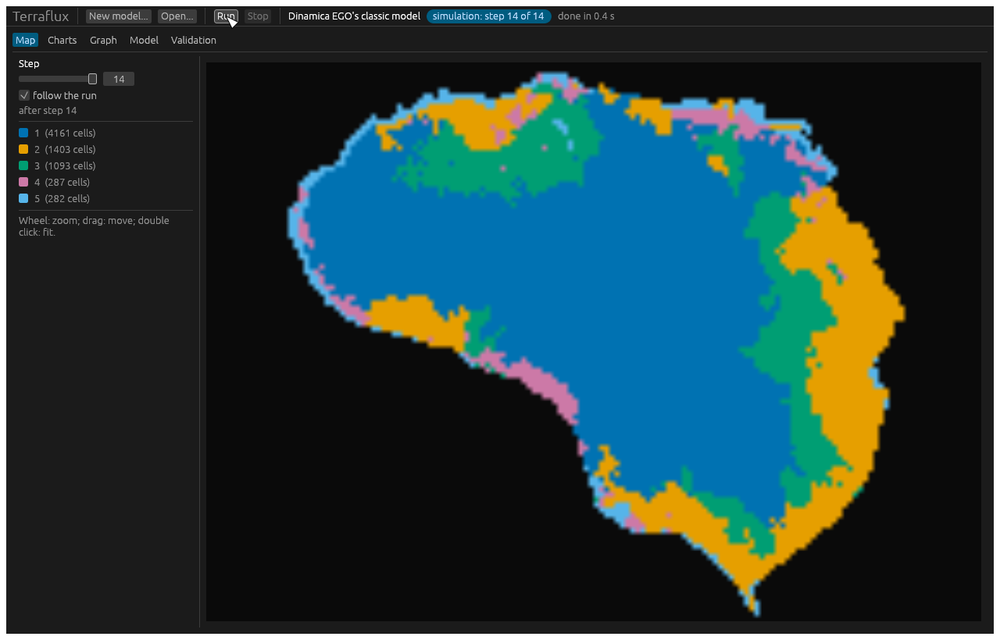
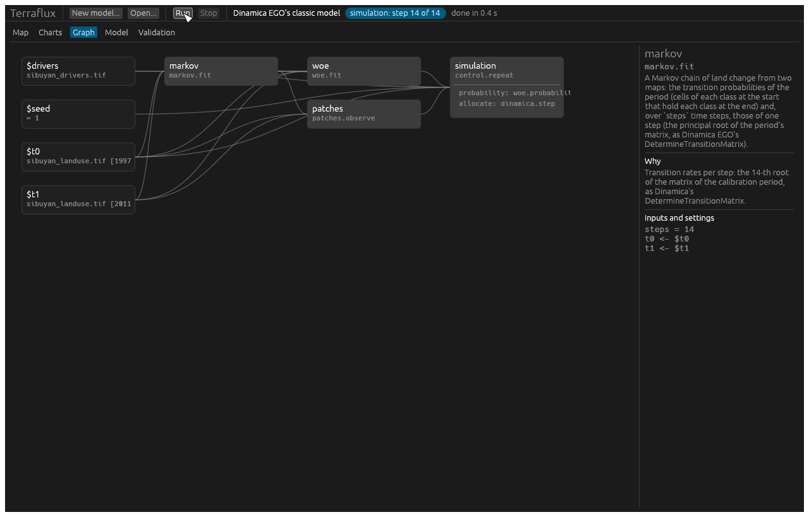

# Terraflux

**Fast, scalable land use and land cover change modelling — from a laptop to the whole planet at 30 m.**

Terraflux is a native application for land change simulation with cellular automata, in the spirit of
Dinamica EGO: a visual model builder, guided data preparation and live maps, with an engine that runs
the same model on one machine or distributed across many headless workers.

> **Status:** 0.7 — the application (a wizard that checks and fixes the data, live maps, a node editor,
> charts and validation), the exact engine, the command line and batches on many machines (replicates,
> scenarios, calibration) run Dinamica EGO's classic model, CLUE-S, the ordered allocation and PLUS's CARS, with
> dynamic variables, bit for bit as landschaft's `ls.simulate` (and so as lulcc); models fitted in Python run
> here unchanged. Map algebra, submodels and WebAssembly plugins change a model's logic; agents (macro agents,
> parcel managers, CRAFTY's competition for land) act on the map in the same graph. A tiled engine runs
> Dinamica EGO's model on maps larger than memory, on one machine or many: the same maps whatever the number of
> workers. The plan is in [`docs/PLAN.md`](docs/PLAN.md) (Portuguese) and the changes in
> [`CHANGELOG.md`](CHANGELOG.md).

## Goals

- **One model, many front-ends.** A model is a typed graph of operators saved as versionable text. The
  guided wizard, the node editor, Python and the text file all read and write the same graph.
- **Easy without hiding anything.** Every automatic choice of the wizard becomes an explicit node in the
  graph, with its reason, so beginners accept sensible defaults and experts change anything.
- **Guided data preparation.** A reference grid per project; automatic harmonisation with the right
  resampling for each kind of data; class legends; observed changes; explanatory variables in one click;
  checks that catch problems before a run.
- **Any scale.** An exact mode, bit for bit with the reference tools on one machine, and a scalable mode
  over tiles: deterministic whatever the partitioning, up to global scenarios at 30 m.
- **Flexible logic.** Map algebra, reusable submodels and pluggable operators (Rust and WASM).
- **Agents.** An agent-based layer on top of the cellular automata, in the same graph.

## Technology

- **Application:** Rust, with an [egui](https://github.com/emilk/egui) + wgpu interface.
- **Simulation kernels:** C++17/OpenMP from [landschaft](https://github.com/sacridini/landschaft), which
  reproduces lulcc, CLUMondo, r.futures, MOLUSCE, OpenLand and diffeR, plus Dinamica EGO's and PLUS's
  methods from their publications.
- **Distribution:** gRPC between a coordinator and workers, with Zarr and COG on shared storage.
- **Python:** through landschaft's `ls.simulate`.

## The application

```bash
terraflux app                 # or: terraflux app model.toml
```

A double click on `terraflux.exe` or `Terraflux.app` (or `terraflux` without a command) opens the application
too, and so does a model file dropped on it or opened with it (on Windows); started that way on Windows, it shows
no console.

- **Panes you arrange:** the model, the operators, the node, the viewer, the simulation's maps, the areas and
  the validation are tabs to drag, split, close (ctrl+W; the View menu turns each on or off) or take to a
  window of their own on another screen (right click on a tab); the layout is kept between sessions. Tab goes
  to the model and Tab again back to the tab you were in. A double click on a node opens its map in a tab of
  its own: one per node, brought to the front when it is open already (a new one once it is closed). The
  model's tab shows its text (TOML) and its problems with a button (Text). The viewer writes the coordinates
  under the pointer in its corner, with the cell's row, column and value.
- **Seeing without writing:** `view.plot` shows a map, a stack, a loop's maps or rasters in a tab of its own,
  refreshed at every run (read, reclassify, plot: no file). What a tab or the viewer shows is saved from it
  (Save output: a file only, or a file and a `raster.write` in the model), in the background.
- **Basemaps:** under any map shown, satellite imagery or a map of the world (Esri's imagery and topographic
  map, OpenStreetMap, OpenTopoMap, Carto), warped by GDAL onto the data's CRS, kept in a cache; the data over it
  shown or hidden, at the opacity chosen.
- **Editing many nodes:** drag on the canvas to select the nodes in a box (shift or ctrl and a click add or take
  one away, ctrl+A all), drag one to move them all, del deletes them; Arrange (ctrl+L) puts the nodes in tidy
  columns by what they read, ordered so that connections cross little. ctrl+R renames the node selected. A
  connection is taken off by dragging it away from its input (dropped on another input: moved there) or by a
  right click on the input.
- **Settings in lists:** a setting of a few values (a method, a shape, a connectivity, yes or no) is chosen in
  a list, its default first; the metrics of the landscape metrics are all of them, those of some types (area
  and edge, shape, core area...) or some one by one.
- **Builder** (where the application opens): open a raster, click the operators of the library (by
  landschaft's subjects, with a search) and they come connected to the node selected; what the node selected gives is shown under the
  canvas (a map with its legend, the maps of a stack or of a loop's steps, a table, a value). A run stops at the
  node shown and takes what did not change from the cache, so after every change of a setting only what it
  touches runs again and its result shows at once (ctrl+enter runs to the node, F5 the whole model). Save a map
  as a raster, the model as a file.
- **From the keyboard:** `/` opens a search of the operators anywhere; type part of a name or of what it does,
  the arrows choose, enter adds it connected to the node selected (which the new node becomes, so a chain is
  built key after key), esc closes the search.
- **Templates:** models to start from, run as soon as they open: MSPA of a forest (a map drawn by a neutral
  landscape model, reclassified, MSPA, plotted), MSPA of your map, a forest cut from a surface by ranges, the
  fragmentation of a forest (FAD at five scales and FOS), its patterns and objects (SPA and Accounting), MSPA's
  edge width compared, the neutral landscape models side by side.
- **Reclassifying:** the rules of `raster.reclassify` as a table (the values, what they become), the classes of
  the map it reads with their share beside them (A rule per class fills it), or its range for a continuous map
  (4 equal ranges), and how to write values, ranges (`0..10`), every other value (`*`) and no data (`nan`).
- **Colours that fit the data,** as landschaft's plot: classes (whole values, few of them) a colour each, other
  values a ramp, centred on 0 in blue and red when they are on both sides of it; what GuidosToolbox gives (MSPA,
  SPA, Accounting, FAD and FOS) in its colours and names, a density's legend in its classes (rare to intact),
  through the plots that show them and in files named as GTB names them; elevations, a
  hillshade and NDVI by their ramps (by the names of their nodes, files and bands).
- **GuidosToolbox:** landschaft's port of GTB, the same bits as GTB's own outputs: MSPA (`landscape.mspa`), the
  MSPA of maps larger than memory by GTB's tiles (`landscape.mspa_tiled`), the simplified pattern analysis
  (`landscape.spa`, 2 to 6 classes), the objects by size (`landscape.accounting`),
  the foreground's density (`fragmentation.fad`, at five scales `fragmentation.fad_multiscale`) and the
  fragmentation at a fixed scale (`fragmentation.fos`, by FAD, FED or FAC, binary maps or % covers), contagion and
  clustering in a window, the spatial entropy, the landscape mosaic, GraySpatCon's metrics of a % cover,
  parcellation, contortion, the Euclidean distance to the foreground's edge, the zones of influence and the
  proximity of the objects, the habitat network of an MSPA map (GTN's components, the importance of its links
  and nodes, Conefor's inputs), the Restoration Planner (status, resistance, cost distance, least-cost path and
  corridor, isochrones), and the simple, morphological, FOS, FAD and mosaic change between two dates, with GTB's
  reports as tables and as GTB's text. They read a map coded as GTB's (0 missing, 1 background, 2 foreground) or
  any map with the foreground's classes given.
- **Landscape metrics:** landscapemetrics' metrics (and FRAGSTATS' extras) per patch, per class, of the
  landscape and in a moving window (`metrics.patch`, `metrics.class`, `metrics.landscape`, `metrics.window`; of
  maps larger than memory by blocks of rows, the same values), of
  sample plots (buffers around points, polygons; `metrics.sample`) and along a series of maps (`metrics.series`,
  by zones or a grid of them), with the correlation between them (`metrics.correlation`), the same values as R's
  landscapemetrics; spatial signatures of zones or landscapes (`metrics.signatures`) with their principal
  components, non-negative factors, clusters and clustergrams (`metrics.pca`, `metrics.nmf`, `metrics.cluster`,
  `metrics.clustergram`), the same clusters as landschaft; tables sorted, filtered and drawn in the viewer (bars,
  lines or points of several metrics at once, by class, zone or cluster; clustergrams; correlation matrices), and
  the maps of a metric per patch
  or class.
- **Spatial prioritization:** Zonation 5's ranking (`prioritize.zonation`), the same rank maps as the z5 binary,
  with its conditions, retention, connectivity transforms, impact assessment and post-processing, and Zonation's
  projects as z5 runs them (`prioritize.zonation_project`: the `.z5` file, its feature list and link files); Marxan 4's
  reserves (`prioritize.marxan`), the same runs as Marxan; ProxIRR's irreplaceability (`prioritize.proxirr`), R's
  proxirr's bits; prioritizr's integer programs (`prioritize.optimize`: min set, min shortfall, max utility, max
  features, phylogenetic diversity, the species-area extinction risk and more; boundary, connectivity and linear
  penalties, neighbour and contiguity constraints; planning units in maps, tables, polygons or H3 hexagons
  (`prioritize.h3_units`); portfolios), prioritizr's
  models bit for bit, solved by HiGHS; management zones; the evaluation of solutions (`prioritize.evaluate`) and
  the calibration of trade-offs (`prioritize.calibrate`).
- **Restoration planning (plangea):** ecological intactness of a human footprint and its gradient as cells are
  restored, the original vegetation of converted land, the area of habitat of species; plangea's bits. The
  restoration plan (`restoration.plan`): the most reduction of the species' extinction risk (and carbon, and
  ecological intactness) within area targets and a budget, exact (a proven bound) or by plangea's steps, or the
  cheapest plan for a benefit; conservation and conversion, trade-off curves, sets of weights compared, projected
  changes, the ecosystems' risk of collapse and their targets.
- **Multi-action planning (prioriactions):** which units to monitor and which actions against which threats to
  take (`prioritize.actions`), prioriactions's model bit for bit.
- **Species distribution models:** occurrence records from GBIF (`sdm.download_gbif`), cleaned by
  CoordinateCleaner's tests (`sdm.clean_occurrences`), thinned, one per cell; the accessible area; the predictors
  without collinearity (usdm's VIF) and their range of autocorrelation; background points (dismo's); folds for
  cross-validation (ENMeval's and blockCV's); MaxNet fitted with cross-validation, its response curves and the
  importance of the predictors; its evaluation (AUC, TSS, Boyce, thresholds) and extrapolation (MESS, MOP, ExDet).
  The whole preparation in one node (`sdm.prepare`) or step by step; landschaft's results, mostly to the bit (the
  template "Species distribution model").
- **Vector features:** read and written by OGR (GeoPackage, Shapefile, GeoJSON...), drawn beside their
  attributes; burnt into maps as landschaft's rasterize, the statistics of maps in polygons, exactextractr's sums
  over polygons, distances to features; planning units of polygons for prioritizr's problems.
- **Rasters of any size:** opening a raster reads its header only; the viewer reads the tiles in view at the
  screen's resolution (in threads, the coarser level shown meanwhile), so a raster of billions of cells shows
  in under half a second and zooms smoothly; a folder or a pattern (`forest/*.tif`) is one stack, a layer per
  band of each file (Open a folder as a stack), to go through.
  Operators that need a map in memory read it then.
- **GDAL:** every format GDAL reads, and by GDAL: `raster.reproject`, `raster.resample`, `raster.match`
  (another raster's grid), `raster.clip`, `raster.convert` (formats, cell types, COG), `raster.mosaic`,
  `raster.terrain` (slope, aspect, hillshade, TRI, TPI, roughness), `raster.fill` (gaps) and
  `distance.proximity` (the distance to some values, on the file whatever its size); `raster.reclassify` by
  Terraflux. A series may hold files of different grids (tiles to join). GDAL is loaded when the
  program runs (no GDAL is needed to build Terraflux): from the folder `gdal` next to the program (the
  installers bring it; `tools/bundle-gdal.ps1` copies one there), `TERRAFLUX_GDAL`, or an installed GDAL.
  Without it, GeoTIFF is read and written by Terraflux itself.
- **Large diagrams:** the canvas is drawn by the GPU (the boxes, ports and connections in a few instanced draws
  whatever their number) and laid out only when the graph changes; texts are written for the nodes in view
  when the zoom makes them readable. Drag the background (or with the middle button) to move, the wheel to zoom,
  Home to see the whole graph. With 10,000 nodes a frame takes about 0.1 ms, dragging a node 0.5 ms.
- **Wizard:** a wizard in three steps picks the model (Dinamica EGO's, CLUE-S, ordered), reads the land use
  maps and the drivers (the dates and steps from the band names), checks the data as soon as it is chosen
  (grids, classes, missing values, constant or collinear drivers) and offers to fix what it can (resampling a
  driver to the land use map's grid), then writes the model with a note on every choice.
- **Panes:** the node's and Prepare at the left, the model over the viewer; the operators in a drawer at the
  window's left edge and in the toolbar. Any tab dragged out of the dock becomes a window of its own, to put on
  another screen. ctrl+O opens a raster or vectors, ctrl+W closes the tab in front, backspace (or delete) deletes
  the node selected.
- **The viewer:** maps over maps (each as opaque as asked) and vectors over them, chosen beside the map or
  stacked by plots in the model (a plot's `under`); a cell clicked on a stack shows its values along the layers
  in a chart; B puts the satellite under the map. **Settings:** themes, the text's size, the zoom, the threads;
  favourites in coloured collections in the operators' library.
- **Legends and weights of evidence:** the classes' names and colours edited in the viewer (a `raster.legend`
  node, carried with the map to the GeoTIFF); the weights of evidence of a fit in bars, its ranges merged or
  split and its weights set by hand, the fit run again.
- **Prepare:** the data of the node selected next to the model's reference grid (the land use map's, suggested
  as soon as one is read): its coordinate system, cells and extent, what differs, and the steps a click away,
  each a node of an operator already there with a note saying why: onto the grid (`raster.match`, resampled by
  what the values are: classes the nearest cell or the most common one, values interpolated or averaged, counts
  summed), reprojected, the slope of a surface, the distance to a class; for vectors the distance to them, burnt
  into the grid, the statistics of the grid's map in each polygon; every raster off the grid put on it at once.
- **The node editor:** connect ports (each connection checked), type values and settings, edit the bodies of
  loops and groups; the note of every node says why it is there.
- **Map:** the maps of the run as they come, step by step, and the maps of the inputs: a stack's one after the
  other (a slider, the arrow keys, play) with small images of all of them; zoom, pan, the class and coordinates
  under the pointer.
- **Charts:** the area of each class along the steps.
- **Validation:** the last map against an observed one: figure of merit, hits, misses and false alarms, and
  Dinamica EGO's fuzzy similarity of the changes in windows of growing size.





If the window stutters when it is moved or resized, how frames reach the screen can be changed:
`TERRAFLUX_PRESENT=novsync` (frames as soon as they are drawn), `TERRAFLUX_LATENCY=2` (frames queued; 1 by
default) and `WGPU_BACKEND=dx12`, `vulkan`, `metal` or `gl` (the graphics interface).

## Quick start

```bash
# a model from Dinamica EGO's classic one, fitted on two maps (14 steps between them)
terraflux new dinamica --t0 landuse.tif:1997 --t1 landuse.tif:2011 --drivers drivers.tif --steps 14 -o model.toml
terraflux check model.toml          # every operator, reference and connection checked
terraflux run model.toml            # writes output/maps.tif (a band per step), steps.csv, weights.csv
terraflux run model.toml --set seed=7 --out other
terraflux ops                       # the operators and what they do
terraflux resample drivers.tif --like landuse.tif -o drivers_aligned.tif
```

`terraflux new clue` and `terraflux new ordered` make lulcc's CLUE-S and ordered models (logistic regressions,
a demand interpolated from observed maps, conversion rules, elasticities, neighbourhoods, restrictions).

## Changing the logic

```toml
[[nodes]]
id = "suitable"
op = "map.calc"                                      # map algebra, as Dinamica EGO's Calculate Map
inputs = { land = "$t0", drivers = "$drivers" }
params = { expression = "if land == 3 and drivers.dist_roads < 500 then nbmean(land == 2, 1) else 0" }

[[nodes]]
id = "forest"
op = "control.submodel"                              # another model file as one node
inputs = { lu = "$t0" }
params = { path = "lib/forest.toml" }

[[nodes]]
id = "keep"
op = "plugin.wasm"                                   # a function in WebAssembly (any language), sandboxed
inputs = { land = "$t0", slope = "suitable.map" }
params = { path = "plugins/keep.wasm" }
```

See [`docs/modelling.md`](docs/modelling.md): the node editor, map algebra, groups and submodels, plugins.

## Agents

Populations of agents carried along the loop with the map: macro agents giving the demand, parcel managers
changing the potential of their parcels (`agents.table`, `agents.parcels`, `agents.update` with rules
`attribute = expression`, `agents.map`, `agents.summary`), and CRAFTY's competition for land between agent
functional types (`crafty.allocate`). See [`docs/agents.md`](docs/agents.md).

## Many runs, many machines

```bash
terraflux submit model.toml --replicates 50 --out replicates            # the cores of this machine
terraflux calibrate model.toml --param patches.isometry=0.5:2.5 --observed landuse.tif:2011 --metric similarity:5

terraflux serve --listen 0.0.0.0:7700                                   # a coordinator
terraflux worker --coordinator http://coordinator-host:7700             # on every machine that works
terraflux submit model.toml --scenarios scenarios.toml --coordinator http://coordinator-host:7700
```

Workers only connect to the coordinator; data travels once, by hash; a task whose worker vanishes runs on
another. See [`docs/cluster.md`](docs/cluster.md) (and the Slurm template in `tools/slurm`).

## Maps larger than memory

```bash
terraflux run model.toml --tiled                          # tiles of 1024 cells, layers in memory
terraflux run model.toml --tiled --tile 2048 --disk layers  # the steps' layers kept on disk
terraflux run model.toml --tiled --threads 8               # threads (default: all the cores but one)
```

The tiled engine runs Dinamica EGO's model tile by tile. Its Markov chains and weights of evidence are the
exact engine's to the bit (they are sums over the tiles); the patches a fit measures are measured within tiles.
Its allocation draws random numbers by counter and finds the seeds of the patches from histograms summed over
the tiles, so with the same fitted pieces the same seed gives the same maps whatever the tiling and the number
of machines, statistically equivalent to the exact engine's (the same areas of change, a similar fuzzy
similarity). Patches grow within `--radius` cells of their seed.

On many machines, the tiles go to a coordinator's workers, the maps and the layers on storage they share:

```bash
terraflux run model.toml --tiled --disk /shared/layers --coordinator http://coordinator-host:7700
```

Landscape metrics read a map larger than memory by blocks of rows (`block_rows` on `metrics.patch`,
`metrics.class`, `metrics.landscape`, `metrics.window`, `metrics.sample`, `metrics.series` and
`metrics.signatures`, and always for rasters on disk of more than 250 million cells), the same values as in
memory: the moving window by strips with the window's half side around them (its maps written to a GeoTIFF, a
band per metric), samples and zones window by window. So do the vectors over rasters: `vector.zonal` by strips of
rows, `vector.extract` from the strips that hold points, `vector.rasterize` into a GeoTIFF strip by strip. MSPA
by GuidosToolbox's overlapping tiles (`landscape.mspa_tiled`) reads and writes a raster on disk tile by tile.

No command takes every core: Rust's tasks, landschaft's OpenMP kernels and the workers of a local cluster share
all the cores but one, unless `--threads` (or `TERRAFLUX_THREADS`) says otherwise.

## From Python

[landschaft](https://github.com/sacridini/landschaft) writes its fitted models as Terraflux graphs:

```python
import landschaft as ls

S = ls.simulate
model = S.presets.dinamica(lu[0], lu[1], drivers, steps=14)   # fitted in Python
model.save("dinamica.json", lu[0], drivers, seed=1)            # the graph and its data
maps = S.terraflux("dinamica.json")                            # run by Terraflux: the maps of model.run
model, inputs = S.Model.load("dinamica.json")                  # and back
```

## The model file

A model is a graph of operators in TOML (or JSON): its inputs, its nodes and its outputs. Each node runs one
operator on inputs that come from the model's inputs (`$name`), from other nodes (`node.port`), from values
carried along a loop (`@name`, `@step`) or literal values; its `note` says why it is there. The models made by
`terraflux new` are written out node by node, so that anything they chose can be read and changed.

Rasters can also come in and go out through nodes, as the builder writes them (paths relative to the model's
folder):

```toml
[[nodes]]
id = "read"
op = "raster.read"
params = { path = "forest.tif" }

[[nodes]]
id = "mspa"
op = "landscape.mspa"                 # GuidosToolbox's MSPA, the same bits
inputs = { map = "read.map" }
params = { foreground = 1, edge_width = 2 }

[[nodes]]
id = "write"
op = "raster.write"
inputs = { value = "mspa.map" }
params = { path = "forest_mspa.tif" }
```

```toml
format = "terraflux/1"

[inputs.t0]
kind = "map"
path = "landuse.tif"
band = "1997"

[[nodes]]
id = "markov"
op = "markov.fit"
note = "Transition rates per step: the 14th root of the matrix of the calibration period."
inputs = { t0 = "$t0", t1 = "$t1", steps = 14 }

[[nodes]]
id = "simulation"
op = "control.repeat"
inputs = { times = 14, landscape = "$t0" }
[nodes.body]
carry = { landscape = "allocate.landscape" }
collect = { maps = "allocate.landscape" }
# [[nodes.body.nodes]] ... woe.probability, dinamica.step

[outputs.maps]
from = "simulation.maps"
```

## Installing

On Windows, the installer (`terraflux-<version>-x64.msi`) puts Terraflux in Program Files with a shortcut in the
Start menu and the folder on the PATH (for `terraflux run`); the zip (`terraflux-<version>-windows-x64.zip`) holds
the same files, to unpack anywhere. Both bring GDAL (the folder `gdal`) and the Visual C++ and OpenMP runtimes:
nothing else is needed, neither Python nor a GDAL of one's own. They are made by

```powershell
tools\make-installer.ps1      # target\installer: the MSI (WiX 5, a .NET tool of the repository) and the zip
```

from the release build, the GDAL of `C:\Program Files\GDAL` (`-Gdal` another) and the runtimes of the newest
Visual Studio.

On macOS, the disk image (`terraflux-<version>-macos-arm64.dmg`) holds `Terraflux.app`, to drag to Applications;
the zip (`terraflux-<version>-macos-arm64.zip`) the same application. It brings GDAL (its libraries in
`Contents/Frameworks/gdal`, GDAL's and PROJ's data in `Contents/Resources`, PROJ's grids of datums left out) and
OpenMP is linked into `terraflux`: nothing else is needed. The command is the application's own
(`ln -s /Applications/Terraflux.app/Contents/MacOS/terraflux /usr/local/bin/terraflux`, for `terraflux run`).
The application is signed ad hoc, not notarized: downloaded, it is opened the first time by a right click and
Open. They are made by

```bash
python3 tools/make-macos-app.py   # target/macos: Terraflux.app, the dmg and the zip
```

from the release build and Homebrew's GDAL (`brew install gdal`; `--gdal` another prefix, `--no-gdal` none:
then an installed GDAL is used). The application asks for the macOS that the GDAL brought was built for
(Homebrew's: the macOS it was installed on).

## Building

Terraflux needs Rust (1.85 or later), CMake and a C++17 compiler (Visual Studio on Windows; on Windows the
CMake of the newest Visual Studio is used; on macOS Apple's clang, with the Command Line Tools, and Homebrew's
OpenMP runtime: `brew install cmake libomp`, or `OpenMP_ROOT` another libomp). Landschaft's C++ kernels come from
the submodule:

```bash
git clone --recurse-submodules git@github.com:sacridini/terraflux.git
cd terraflux
cargo build --release          # target/release/terraflux
cargo test --release           # parity with landschaft included
```

On Windows keep the build folder's path short (`CARGO_TARGET_DIR`): MSBuild fails on paths over 260
characters. `LANDSCHAFT_DIR` points the build at another landschaft checkout, `LANDSCHAFT_EIGEN_DIR` at a local copy of
Eigen 3.4. `tools/make_reference.py` writes the reference outputs of the parity tests with landschaft. They were
written on Windows: on macOS, whose maths library rounds some functions (`exp`, `log`, `pow`) otherwise in the last
bit, the parity tests of the logistic regressions (CLUE-S, ordered), of Dinamica EGO's model on Sibuyan and of
plangea's intactness differ from them in the last bit.

| Crate | What it holds |
|---|---|
| `terraflux-graph` | the model graph: file format, references, signatures, checks, submodels |
| `terraflux-ops` | the operators (Markov chains, demands, logistic regression, weights of evidence, CLUE-S, ordered, Expander/Patcher, map algebra, WebAssembly plugins, agents, CRAFTY) and the presets |
| `terraflux-exec` | the exact engine: inputs, graph run, outputs; the checks of the data |
| `terraflux-engine` | the tiled engine: fits by reduction, counter-based random numbers, allocation by thresholds |
| `terraflux-raster` | grids, rasters, GeoTIFF reading and writing in pure Rust (BigTIFF, tiles, windows, LZW, Deflate, predictors), resampling |
| `terraflux-ls-sys` | the bridge to landschaft's C++ kernels |
| `terraflux-app` | the application (egui, wgpu): wizard, node editor, live maps, charts, validation |
| `terraflux-dist` | the coordinator, the workers and the batches (gRPC) |
| `terraflux-cli` | the `terraflux` command |

## License

GPL-3.0-or-later.
