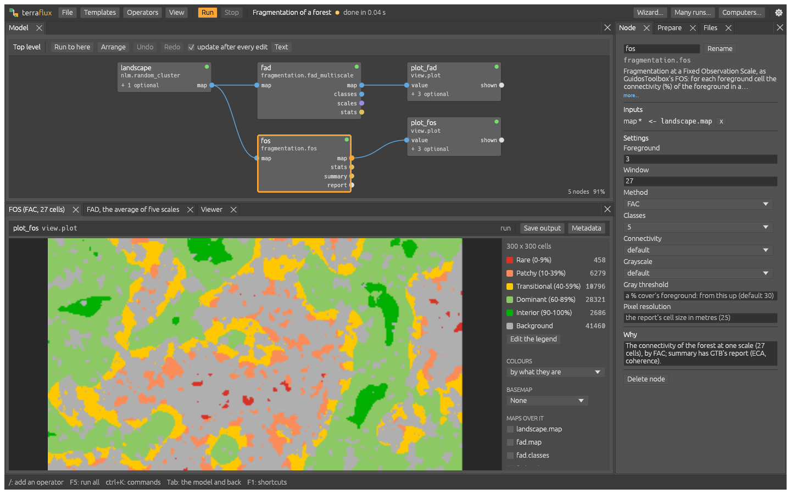
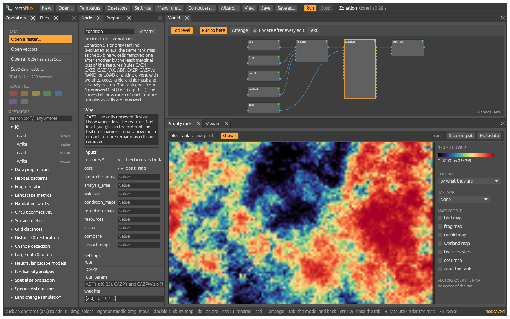
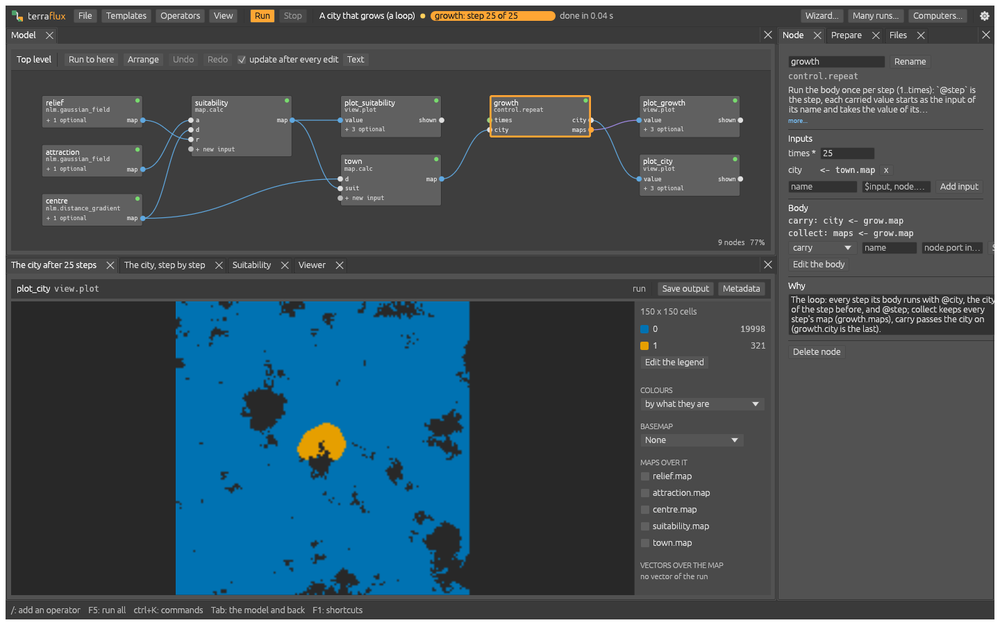
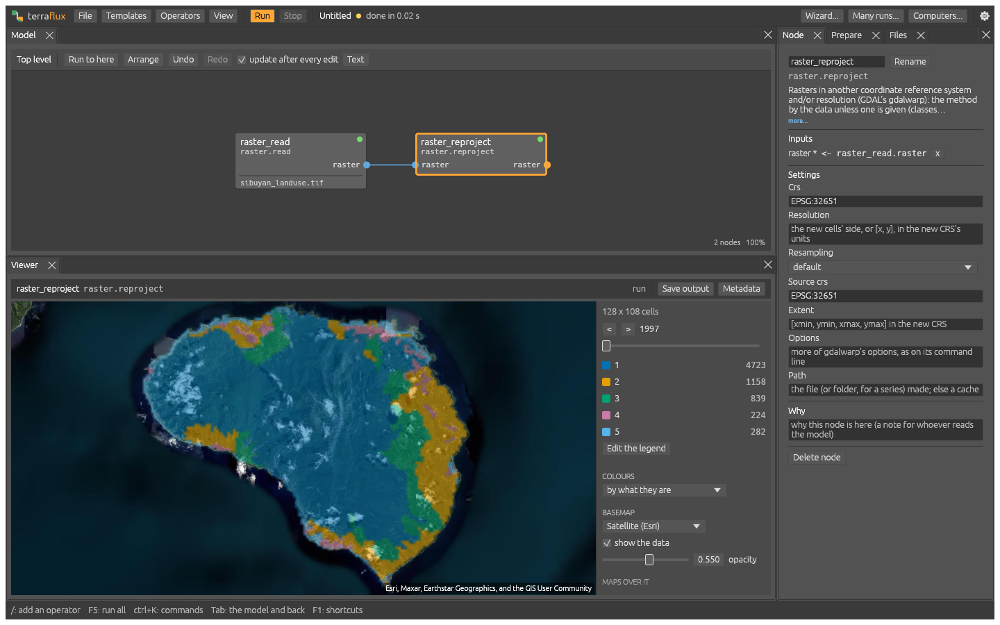
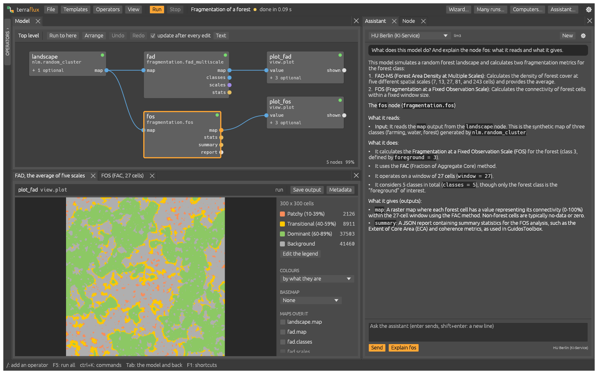
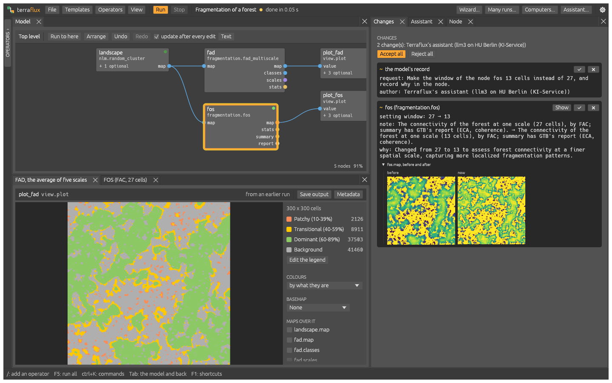
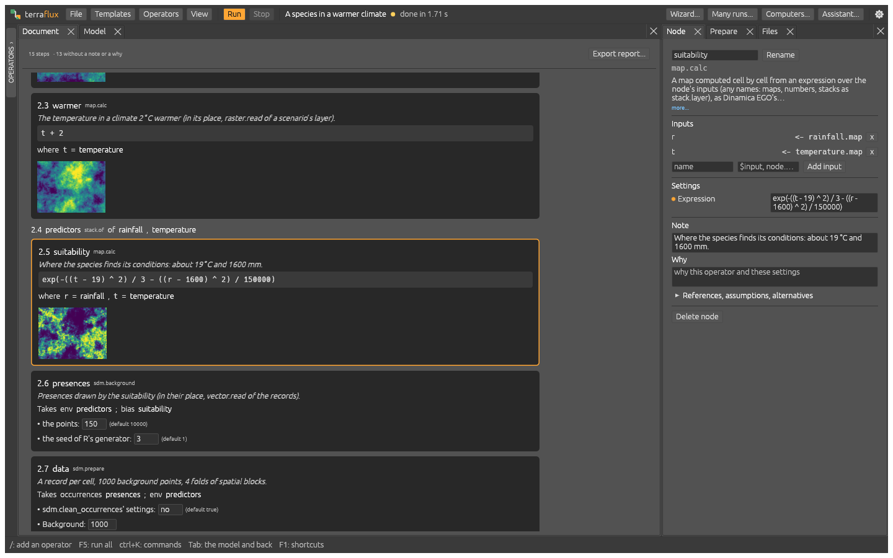

<p align="center">
  <picture>
    <source media="(prefers-color-scheme: dark)" srcset="assets/logo/terraflux-logo-dark.svg">
    
  </picture>
</p>

<p align="center">
  <strong>Landscape ecology, conservation planning and land change simulation in one open-source application.</strong><br>
  Built on the methods of the reference tools, from a laptop to a cluster.
</p>

<p align="center">
  <a href="LICENSE"></a>
  
  
  
</p>

<p align="center">
  <a href="#features">Features</a> ·
  <a href="#installation">Installation</a> ·
  <a href="#quick-start">Quick start</a> ·
  <a href="#scaling-up">Scaling up</a> ·
  <a href="#documentation">Documentation</a> ·
  <a href="#building-from-source">Building</a>
</p>

<p align="center">
  
</p>

Terraflux is a native desktop application and command line for spatial ecology. Habitat patterns, landscape
metrics, connectivity, spatial prioritization, restoration planning, species distributions and land use change
are operators in one visual model builder: connect them node by node, and every result shows as soon as the
graph changes. The same model runs unchanged from the command line, on all the cores of a workstation, on the
computers of a local network or on a Slurm cluster, and on maps larger than memory.

## Why Terraflux

- **Results you can trust.** The methods follow their reference implementations, and many give the same
  results to the bit: GuidosToolbox, landscapemetrics, Zonation 5, Marxan, prioritizr, plangea, Dinamica EGO and
  lulcc's CLUE-S among them. Parity tests against [landschaft](https://github.com/sacridini/landschaft) run in the
  test suite.
- **No code needed, nothing hidden.** More than 340 operators in a searchable library, 45 ready-to-run templates and
  a wizard that checks and fixes the data. Every automatic choice is a visible node, with a note on why it is
  there.
- **One model, many front-ends.** A model is a typed graph saved as readable text (TOML or JSON). The builder,
  the wizard, the command line and Python all read and write the same file.
- **Any scale.** An exact engine on one machine, and a tiled engine that gives the same maps whatever the number
  of tiles, threads or machines.

## Features

| Field | What Terraflux does | Methods of |
|---|---|---|
| **Land change simulation** | Dinamica EGO's model (Markov chains, weights of evidence, Expander and Patcher, the Patcher of a stock, endogenous roads), CLUE-S, ordered allocation, PLUS's land expansion analysis and CARS, cellular automata in loops, validation by fuzzy similarity | Dinamica EGO, lulcc, PLUS, landschaft |
| **Carbon and REDD+** | Emissions and removals of land change with regrowth curves; Verra's VT0007 deforestation risk maps, their fit, allocation of the expected deforestation and assessment | IPCC, UDef-ARP |
| **Machine learning** | Random forests and histogram gradient boosting of classes or values on tables and maps, their predictions, the predictors' importances (impurity, permutation) and partial dependence, the potential of each class to appear | scikit-learn, landschaft |
| **Map accuracy and area** | Stratified random samples sized and drawn for a map, the error matrix, user's, producer's and overall accuracies and each class's area with confidence intervals | Olofsson et al. (2014), mapaccuracy |
| **Spatial statistics** | Every cell's trend along a series of maps (Mann-Kendall, Sen's slope), global and local Moran's I (LISA's clusters), Getis-Ord's Gi* hot and cold spots, variograms, ordinary kriging and inverse distance weighting of points | pymannkendall, PySAL's esda, gstat |
| **Habitat patterns** | MSPA (also tiled, for maps larger than memory), SPA, Accounting, FAD and FOS fragmentation, landscape mosaic, spatial entropy, change between two dates | GuidosToolbox |
| **Landscape metrics** | Patch, class and landscape metrics, moving windows, sample plots, time series, spatial signatures with PCA, NMF and clustering | landscapemetrics, FRAGSTATS |
| **Connectivity** | Habitat graphs and Conefor's indices, MSPA networks, circuit theory, least-cost paths and corridors, random walks, metapopulations (Hanski's incidence function model) | Conefor, Circuitscape, Omniscape, gdistance, MetaLandSim |
| **Conservation planning** | Zonation 5 rankings and projects, Marxan reserves, prioritizr's integer programs solved by HiGHS, irreplaceability, multi-action planning | Zonation, Marxan, prioritizr, ProxIRR, prioriactions |
| **Restoration** | Ecological intactness, restoration plans under area targets and budgets, trade-off curves | plangea |
| **Species distributions** | GBIF records, CoordinateCleaner's tests, thinning, background points, spatial folds, MaxNet, GLM and random forests, evaluation and extrapolation (MESS, MOP), dispersal through the periods of a changing climate | dismo, ENMeval, blockCV, usdm, MigClim |
| **Agents** | Macro agents, parcel managers and CRAFTY's competition for land, in the same graph as the cellular automata | CRAFTY |
| **Hydrology and ecosystem services** | Depressions filled and breached, flow directions and accumulation (D8, D-infinity, multiple flow), streams, HAND, watersheds, wetness indices; rivers as a network (points snapped onto it, the land upstream of each link or point, each point's catchment, distances along it, the centrality of the links, the dendritic connectivity index of dams and which to remove); InVEST's carbon, habitat quality, annual water yield and sediment delivery ratio; SWAT+ watershed simulations | WhiteboxTools, pygeoprocessing, hydrographr, riverconn, InVEST, SWAT+ |
| **Surfaces and data** | Terrain, geomorphons, Brazil's Forest Code (APPs of rivers, lakes, springs, slopes and hilltops; Reserva Legal balances), gravity potentials, distances, map algebra, reprojection and resampling, downloads of WorldClim, CHELSA, the Copernicus DEM, SoilGrids, MapBiomas, Hydrography90m and Environment90m, vectors by OGR, zonal statistics, tables filtered, computed, summarised, joined, sorted and pivoted, Monte Carlo uncertainty, global sensitivity (Morris, Sobol) | GDAL, GRASS, exactextractr, dplyr, tidyr |

<table>
  <tr>
    <td width="50%"></td>
    <td width="50%"></td>
  </tr>
  <tr>
    <td align="center"><sub>Spatial prioritization: Zonation's priority rank</sub></td>
    <td align="center"><sub>Land change: a city that grows in a loop of 25 steps</sub></td>
  </tr>
  <tr>
    <td width="50%"></td>
    <td width="50%">
      <h4>The application</h4>
      <ul>
        <li>A node editor drawn by the GPU: 10,000 nodes at about 0.1 ms a frame</li>
        <li>Results shown as the graph changes, from a cache that reruns only what changed</li>
        <li>Rasters of any size shown at once, tiles read at the screen's resolution</li>
        <li>Satellite and map basemaps under the data, maps and vectors stacked</li>
        <li>Rasters and vectors dropped from the file manager become nodes</li>
        <li>Panes you can arrange, and take to another screen</li>
      </ul>
    </td>
  </tr>
  <tr>
    <td align="center"><sub>Basemaps: a land use map over satellite imagery</sub></td>
    <td></td>
  </tr>
</table>

## Installation

Each release ships self-contained packages: GDAL and the runtimes are bundled, nothing else is needed (neither
Python nor a GDAL of your own).

| Platform | Package | Notes |
|---|---|---|
| **Windows** 10 and 11, 64-bit | `terraflux-<version>-x64.msi` | Start menu shortcut, `terraflux` on the `PATH` |
| | `terraflux-<version>-windows-x64.zip` | Portable: unpack anywhere |
| **macOS**, Apple silicon | `terraflux-<version>-macos-arm64.dmg` | Drag `Terraflux.app` to Applications |
| **Linux** x86-64, glibc 2.39+ (Ubuntu 24.04+, Debian 13+, Fedora 40+, Arch) | `terraflux_<version>_amd64.deb` | `sudo apt install ./terraflux_<version>_amd64.deb` |
| | `terraflux-<version>-1.x86_64.rpm` | Fedora, openSUSE: `sudo dnf install ./terraflux-<version>-1.x86_64.rpm` |
| | `terraflux-<version>-1-x86_64.pkg.tar.zst` | Arch: `sudo pacman -U terraflux-<version>-1-x86_64.pkg.tar.zst` |
| | `terraflux-<version>-linux-x64.tar.gz` | Unpack and run `install.sh`, no root needed |

> [!NOTE]
> The macOS application is signed ad hoc, not notarized: the first time, open it with a right click and **Open**.

<details>
<summary>Making the packages</summary>

```powershell
tools\make-installer.ps1                # Windows: the MSI (WiX 5) and the zip, in target\installer
```

```bash
python3 tools/make-macos-app.py         # macOS: Terraflux.app, the dmg and the zip, in target/macos
python3 tools/make-linux-package.py     # Linux: the folder, the tar.gz, the .deb, the .rpm and Arch's, in target/linux
```

Each script starts from the release build and bundles a GDAL: on Windows the one in `C:\Program Files\GDAL`
(`-Gdal` another), on macOS Homebrew's (`--gdal` another prefix), on Linux the system's (`--gdal` another
prefix; patchelf is needed, dpkg-deb for the .deb and [nfpm](https://nfpm.goreleaser.com) for the .rpm and
Arch's package). Build the Linux packages on the oldest distribution to support. At every tag `vX.Y.Z` GitHub
Actions makes them all (`.github/workflows/release.yml`), tries the Linux ones installed in containers of Ubuntu,
Debian, Fedora and Arch, and publishes them as the tag's release.
Ubuntu's GDAL 3.8 lacks geodesic areas, which some landscape metrics and species distribution steps need:
GDAL 3.9 or later is recommended.

</details>

## Quick start

Open the application with a double click, or from a terminal:

```bash
terraflux app                 # the model builder
terraflux app model.toml      # with a model
```

Start from **Templates** (each runs as soon as it opens, its data drawn by neutral landscape models), open a raster
with **File > Open a raster or vectors...** (ctrl+O), from the **Files** drawer or by dropping one on the window, then click operators in the library: each comes connected to
the node selected. Press `/` to search the operators from the keyboard.

The same work from the command line:

```bash
# a model from Dinamica EGO's classic one, fitted on two maps 14 steps apart
terraflux new dinamica --t0 landuse.tif:1997 --t1 landuse.tif:2011 --drivers drivers.tif --steps 14 -o model.toml
terraflux check model.toml          # every operator, reference and connection checked
terraflux run model.toml            # output/maps.tif (a band per step), steps.csv, weights.csv
terraflux run model.toml --set seed=7 --out other
terraflux report model.toml --run   # model.html: the model as a document, its maps in it (-o report.pdf: a PDF)
terraflux ops                       # the operators and what they do
```

`terraflux new clue` and `terraflux new ordered` make lulcc's CLUE-S and ordered models.

### With an AI assistant

`terraflux mcp` is a [Model Context Protocol](https://modelcontextprotocol.io) server: an assistant such as Claude
Desktop, Claude Code, Gemini CLI or Codex builds, checks and runs models through it, from a request in plain
words, with the same checks as the node editor. With the model open in the application, every edit appears on the
canvas as it is made (ctrl+Z undoes it).

```bash
claude mcp add --scope user terraflux -- terraflux mcp    # Claude Code
gemini mcp add -s user terraflux terraflux mcp            # Gemini CLI
codex mcp add terraflux -- terraflux mcp                  # Codex
```

For Claude Desktop, add to its `claude_desktop_config.json` (Settings, Developer, Edit Config):

```json
{ "mcpServers": { "terraflux": { "command": "terraflux", "args": ["mcp"] } } }
```

The application has an assistant of its own too (View, Assistant): a chat beside the graph with the same tools,
on the model open. Ask what a model or a node does ("Explain" asks about the node selected), for a change, or for
a run and what it gave; each change shows on the canvas at once and ctrl+Z undoes it. The assistant talks to any
server of OpenAI's chat completions API with tool calling:

- a university's open models: the HU Berlin's KI-Service (Qwen, from its network or VPN, no key), the GWDG's
  Chat AI;
- a model on this computer, offline: Ollama, LM Studio, llama.cpp's server;
- a commercial provider: OpenAI, Anthropic.

Its settings take the server's address, its model and, when it asks for one, a key, kept in the system's store of
credentials. "Test the connection" says whether the server answers, has the model and lets it call tools. For a
small model, "Few tools" offers only those to explain, change settings, run and check.



What an assistant changes (in the application, or through `terraflux mcp` with the model open) comes to the
**Changes** pane as a pull request's review: the nodes added, removed and changed, each connection and setting
before and after, the maps the changed nodes give before and now side by side, the changed nodes outlined on the
canvas. Each change is accepted or rejected, or all at once. File, Compare lists the same way the differences
with the saved file, another file or the last commit.



The **Document** pane reads the same graph as the methods section of a paper, for whoever checks a model rather
than builds it: its data, preparation, model, validation and results, a step per node with its note, why and
settings in words, map algebra's expressions linked to the nodes they read, loops with their bodies, the plots as
numbered figures and the maps and tables of the last run. A step's name selects its node; its settings are edited
in place. File, Export report writes it as one HTML page or a PDF, as does `terraflux report model.toml`.
**Group the model by stage** (ctrl+K) puts it in a group per stage, each with a note: a few blocks on the
canvas, opened one at a time, and a section per stage in the document; zoomed out, a model without groups shows
its stages framed and named. The **Parameters** pane shows the values a user is to change as a form (sliders,
choices, a unit and a help each), keeps them as named scenarios and compares scenarios side by side, their maps
and differences; `terraflux run model.toml --scenario name` runs one.



**Why does this cell have this value?** Right-click a cell of any map, then **Trace this cell** (or **Ask the
assistant why**): the Trace pane walks
back through the graph and shows, node by node, the value each gave there and how (map algebra's expression with
the values in place of its names, the cells around for a neighbourhood, the layers a model weighs, a loop's value
step by step; inside the loops on demand). **Ask the assistant why** has the assistant explain the trace in
words; its tool `trace_cell` (in the application and in `terraflux mcp`) gives an assistant the same chain, so it
explains a result from what made it rather than from what the model should do; `last_trace` gives an assistant
through `terraflux mcp` the cell you traced last, and its prompt `explain_cell` (a slash command in Claude Code)
asks it to explain that cell (the cell's menu, **Explain with an MCP assistant**, copies such a request too).

**Why did it fail?** When a run fails, the status bar says so and the **Problems** pane explains it: the node that
failed, its message and what it was given side by side (each input's grid: size, cells, coordinate system, what
differs marked), with what likely does not fit and what puts it right (raster.match, raster.reproject); then the
graph's checks and the data's findings, each a click away from its node. The assistant is told the same.

### Models as text

A model is a graph of operators. Each node reads the model's inputs (`$name`), other nodes' outputs
(`node.port`), values carried along a loop (`@name`) or literal values:

```toml
[[nodes]]
id = "read"
op = "raster.read"
params = { path = "forest.tif" }

[[nodes]]
id = "mspa"
op = "landscape.mspa"                 # GuidosToolbox's MSPA, the same bits
inputs = { map = "read.raster" }
params = { foreground = 1, edge_width = 2 }
note = "The forest's core, edges and corridors."
why = "Core and corridors are what a species of the interior moves through."
refs = ["Soille and Vogt (2009), Morphological segmentation of binary patterns"]

[[nodes]]
id = "write"
op = "raster.write"
inputs = { value = "mspa.map" }
params = { path = "forest_mspa.tif" }
```

A model is also the record of its choices: besides its `note`, a node may say `why` it was chosen, the `refs` it
rests on, its `assumptions` and the `alternatives` set aside; the model, the `request` it answers, a `summary` of
the conversation that led to it and its `author` (a person, an agent, or both). None of them changes what the model
gives; the assistants fill them, and the Node pane shows and edits them.

Map algebra (`map.calc`), reusable submodels (`control.submodel`), loops and sandboxed WebAssembly plugins
(`plugin.wasm`) change a model's logic: see [`docs/modelling.md`](docs/modelling.md).

## Scaling up

**Many runs.** Replicates, scenarios and calibration, on the cores of one machine or on many. The **Many runs**
pane does the same without the command line.

```bash
terraflux submit model.toml --replicates 50 --out replicates
terraflux calibrate model.toml --param patches.isometry=0.5:2.5 --observed landuse.tif:2011 --metric similarity:5
```

**Many machines.** A coordinator and workers; data travels once, by hash, and a task whose worker vanishes runs on
another. On a local network the computers find each other from a code (TLS, the code checked both ways); a Slurm
cluster or an SSH server is saved once and used without logging in.

```bash
terraflux serve --listen 0.0.0.0:7700 --code                         # prints its code
terraflux worker --code K7QM-2XPA-9DTE                               # on every machine that helps

terraflux cluster add hpc --host me@login.cluster.edu --slurm --nodes 4 --cpus 32 --time 02:00:00
terraflux submit model.toml --replicates 500 --on hpc --out replicates
```

**Maps larger than memory.** The tiled engine runs Dinamica EGO's model tile by tile, on one machine or many; with
the same fitted pieces, the same seed gives the same maps whatever the tiling and the number of machines.
Landscape metrics, MSPA and the vector operators read large rasters by blocks, with the same values as in memory.

```bash
terraflux run model.toml --tiled --tile 2048 --disk layers
terraflux run model.toml --tiled --disk layers --coordinator http://coordinator-host:7700
```

See [`docs/cluster.md`](docs/cluster.md) for the details, and `tools/slurm` for a Slurm template.

## From Python

[landschaft](https://github.com/sacridini/landschaft) writes its fitted models as Terraflux graphs:

```python
import landschaft as ls

S = ls.simulate
model = S.presets.dinamica(lu[0], lu[1], drivers, steps=14)   # fitted in Python
model.save("dinamica.json", lu[0], drivers, seed=1)            # the graph and its data
maps = S.terraflux("dinamica.json")                            # run by Terraflux
```

## Documentation

| | |
|---|---|
| [`docs/modelling.md`](docs/modelling.md) | The node editor, map algebra, groups, submodels, parameters and scenarios, plugins |
| [`docs/agents.md`](docs/agents.md) | Agents and CRAFTY's competition for land |
| [`docs/cluster.md`](docs/cluster.md) | Batches, coordinators, workers and clusters |
| [`website/`](website/) | The documentation website: a quickstart, 99 tutorials for ecologists in 18 fields, the CLI and operator references (`python website/build.py`) |
| [`CHANGELOG.md`](CHANGELOG.md) | The changes of every release |
| [`docs/PLAN.md`](docs/PLAN.md) | The roadmap (in Portuguese) |

## Building from source

Terraflux needs Rust 1.85 or later, CMake and a C++17 compiler: Visual Studio on Windows, Apple's clang with
Homebrew's OpenMP on macOS (`brew install cmake libomp`), GCC on Linux (`apt install build-essential cmake`).
landschaft's C++ kernels come from a submodule. GDAL is loaded at run time and is not needed to build.

```bash
git clone --recurse-submodules git@github.com:sacridini/terraflux.git
cd terraflux
cargo build --release          # target/release/terraflux
cargo test --release           # parity with landschaft included
```

<details>
<summary>Notes on building and testing</summary>

- On Windows, keep the build folder's path short (`CARGO_TARGET_DIR`): MSBuild fails on paths over 260 characters.
- `LANDSCHAFT_DIR` points the build at another landschaft checkout, `LANDSCHAFT_EIGEN_DIR` at a local copy of
  Eigen 3.4.
- GDAL is found next to the program (the folder `gdal`, which the packages bring and `tools/bundle-gdal.ps1`
  fills), in `TERRAFLUX_GDAL`, or installed. Without it, GeoTIFF is still read and written by Terraflux itself.
- The parity references were written on Windows (`tools/make_reference.py`). Other maths libraries round some
  functions differently in the last bit, so a few parity tests differ there on macOS and Linux (the logistic
  regressions, Dinamica EGO on Sibuyan, terrain slope), and Ubuntu 24.04's GDAL 3.8 lacks geodesic areas.
- If the window stutters when moved, try `TERRAFLUX_PRESENT=novsync`, `TERRAFLUX_LATENCY=2` or
  `WGPU_BACKEND=dx12|vulkan|metal|gl`.

</details>

| Crate | Contents |
|---|---|
| `terraflux-graph` | The model graph: file format, references, signatures, checks, submodels |
| `terraflux-ops` | The operators and the model presets |
| `terraflux-exec` | The exact engine and the data checks |
| `terraflux-engine` | The tiled engine: fits by reduction, counter-based random numbers, allocation by thresholds |
| `terraflux-raster` | Grids, rasters and a pure-Rust GeoTIFF reader and writer (BigTIFF, tiles, LZW, Deflate) |
| `terraflux-gdal` | GDAL and OGR, loaded at run time |
| `terraflux-ls-sys` | The bridge to landschaft's C++ kernels |
| `terraflux-app` | The application (egui and wgpu) |
| `terraflux-dist` | The coordinator, the workers and the batches (gRPC) |
| `terraflux-cli` | The `terraflux` command |

## Acknowledgements

Terraflux stands on [landschaft](https://github.com/sacridini/landschaft)'s C++ kernels and on
[egui](https://github.com/emilk/egui), [wgpu](https://wgpu.rs), [GDAL](https://gdal.org) and
[HiGHS](https://highs.dev). Its methods are those of the tools named above and of their authors' publications.

## License

Terraflux is free software, released under the [GNU General Public License v3.0 or later](LICENSE).
